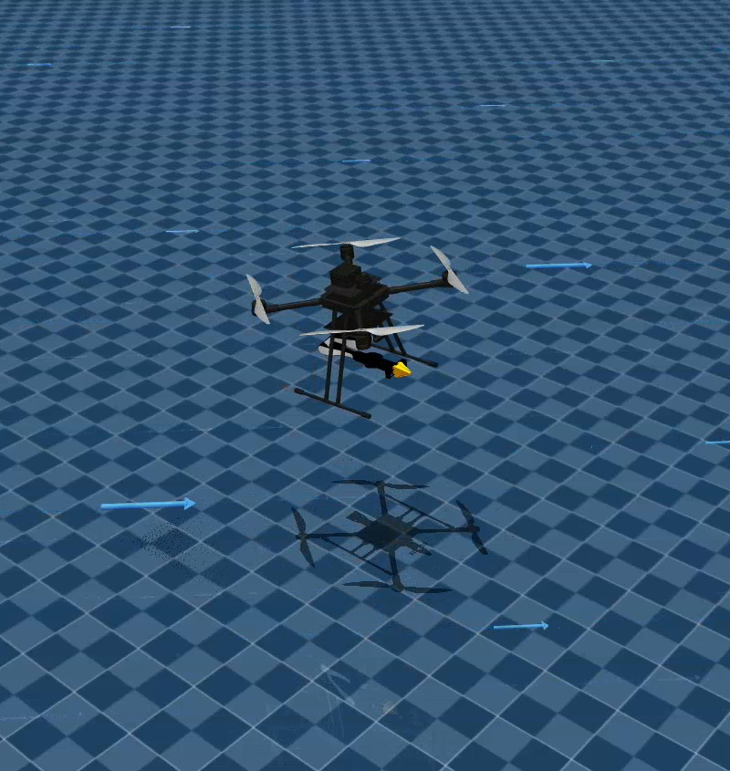

# Wind_disturbance_simulation_part1

**English** | [简体中文](README.zh-CN.md)

Single-UAV wind disturbance simulation in MuJoCo with PX4 SITL, a PINN aerodynamic surrogate, and interactive trajectory control. The aircraft is an X4-950 with an Airbot Play arm.

## 1. Simulation demonstration

https://github.com/user-attachments/assets/5404e7aa-410a-489f-a724-ee3c1227da1d

[Download the original MP4 (about 66 seconds)](docs/media/videos/Wind%20field%20simulation%20Demo.mp4)

<table>
  <tr>
    <td width="50%" align="center" valign="top">
      <a href="docs/media/images/MJCF%20model.png"> X4-950 + Airbot Play model</a>
    </td>
    <td width="50%" align="center" valign="top">
      <a href="docs/media/images/Control%20UI.png"> Control panel</a>
    </td>
  </tr>
  <tr>
    <td width="50%" align="center" valign="top">
      <a href="docs/media/images/wind-field-in-flight.jpg"> In-flight wind visualization</a>
    </td>
    <td width="50%" align="center" valign="top">
      <a href="docs/media/images/Motion%20tracking.png"> Circular trajectory tracking</a>
    </td>
  </tr>
</table>

The dashed gray line is the target. The red line is the actual trajectory.

## 2. Simulation capabilities

- PX4 closed-loop flight with XYZ targets and Figure-8, Ellipse, Circle and Square trajectories.
- Adjustable, uniform horizontal wind from 0 to 10 m/s with the default backend.
- A pretrained X4-950 PINN converts wind into additional aerodynamic forces.
- MuJoCo visualization, a control panel and trajectory comparison plots.

## 3. Project structure

~~~text
Wind_disturbance_simulation_part1/
├── src/
│   ├── wind_field_simulation/
│   │   ├── simulation.py       # MuJoCo, flight control and panel
│   │   ├── wind_backends.py    # PINN and analytical force adapters
│   │   ├── training/           # Reference data, training and evaluation
│   │   └── assets/             # MuJoCo models and assets
│   │       ├── scenes/default/
│   │       │   └── robot_quadrotor_950_with_arm.xml
│   │       ├── robot_models/
│   │       │   ├── quadrotor_950/
│   │       │   │   ├── quadrotor_950.xml
│   │       │   │   └── meshes/
│   │       │   ├── airbot_play/
│   │       │   │   ├── airbot_play.xml
│   │       │   │   └── meshes/
│   │       │   └── scenes/
│   │       │       └── ground.xml
│   │       ├── checkpoints/     # Pretrained weights
│   │       └── configs/         # PX4 parameters
│   └── pymavlink/              # Bundled MAVLink library
├── configs/pinn/               # Training configurations
├── runtime/px4/                # Prebuilt PX4 SITL
├── scripts/                    # Launch and experiment entry points
├── tests/                      # Offline checks
├── docs/                       # Guides, reports and demo media
├── licenses/                   # Third-party licenses
├── outputs/                    # Generated logs and results
├── pyproject.toml
└── requirements.txt
~~~

MuJoCo scene entry: [robot_quadrotor_950_with_arm.xml](src/wind_field_simulation/assets/scenes/default/robot_quadrotor_950_with_arm.xml).

## 4. Installation

Tested on **Ubuntu 24.04 x86-64 / Python 3.12**, with MuJoCo 3.6.0, NumPy 2.4.4, PyTorch 2.11.0 and Matplotlib 3.10.9. The GUI requires Tk and OpenGL.

The bundled PX4 runtime needs Gazebo Transport 13, Messages 10 and Protobuf libraries. Follow the [installation guide](docs/INSTALL.en.md); resolve every “not found” entry from **ldd** before launch.

~~~bash
git clone https://github.com/Chenghao-Huang1218/Wind_disturbance_simulation_part1.git
cd Wind_disturbance_simulation_part1
python3.12 -m venv .venv
source .venv/bin/activate
python -m pip install torch==2.11.0 --index-url https://download.pytorch.org/whl/cpu
python -m pip install -e '.[dev]'
ldd runtime/px4/bin/px4
~~~

## 5. Simulation startup

From the repository root, open two terminals.

**Terminal 1 — PX4 SITL**

~~~bash
source .venv/bin/activate
bash scripts/run_px4_sitl.sh
~~~

**Terminal 2 — MuJoCo and control panel**

~~~bash
source .venv/bin/activate
python scripts/run_simulation.py
~~~

The supplied checkpoint and PX4 binary are ready to use; normal operation requires no training or PX4 build.

## 6. Control panel

1. Wait for **PX4: connected**. Click **Unlock**, wait for **armed**, then click **Takeoff**.
2. Use **X± / Y± / Z±** for 0.5 m world-frame target increments, or select a trajectory. Circle defaults to a 1 m diameter and a 10 s period.
3. Enter X/Y wind in m/s and click **Apply Wind**. Click **Wind OFF** to enable wind; **Wind ON** disables it.
4. Click **Land**, wait for touchdown, then **Exit**. Exit closes the simulation and the launcher's PX4 process.

| Control | Behavior |
| --- | --- |
| Figure-8 / Ellipse / Circle / Square | Predefined flight trajectories |
| Apply Wind | Accept new X/Y values; does not enable wind |
| Set / Speed | Accepted components / resultant wind speed |
| Emergency | Immediately stop simulated rotors |

Wind inputs start empty. The resultant speed must satisfy $\sqrt{w_x^2+w_y^2}\le10$ m/s; positive values mean air moving along the positive world axis. Wind Z and applied force Z are zero. Blue markers show horizontal wind direction.

The default **pinn-x4** backend uses v3 with ±20% group drag variation and horizontal gusts (1.5 m/s peak, 4 s period, seed 42). Gusts are added after you apply the baseline wind and switch wind on. For nominal drag and steady wind, pass `--drag-variation 0 --gust-amplitude 0`. [v3 model card](docs/models/x4-950-pinn-wind-randomized-v3.md)

## 7. PINN training data generation

### Baseline analytical model and key parameters

The scalar quadratic drag law is $D=\tfrac12\rho V^2 C_D A$, where $V$ is relative airspeed. The reference applies this law to 29 fixed-geometry proxies for the X4-950 and Airbot Play. For proxy $j$, the equations give local relative airspeed, axis-wise drag, the total world-frame force, and the paired horizontal disturbance acceleration:

$$
\begin{aligned}
\mathbf u_j(\mathbf w^W)
 &= Q_j^{\mathsf T}\!\left[R_{WB}^{\mathsf T}(\mathbf v_O^W-\mathbf w^W)
    +\boldsymbol\omega^B\times\mathbf r_j^B\right],\\
\mathbf f_{j,0}(\mathbf w^W)
 &= -\tfrac12\rho\,(\mathbf C_D\odot\mathbf A_j)
      \odot\mathbf u_j\odot|\mathbf u_j|,\\
\mathbf F_0^W(\mathbf w^W)
 &= R_{WB}\sum_{j=1}^{29}Q_j\mathbf f_{j,0}(\mathbf w^W),\\
\mathbf y_{xy,0}^W
 &= \frac{P_{xy}}{m}
    \left[\mathbf F_0^W(\mathbf w^W)-\mathbf F_0^W(\mathbf 0)\right].
\end{aligned}
$$

$R_{WB}$ maps body to world, $Q_j$ maps proxy axes to the body frame, and $\mathbf r_j^B$ is the offset from the root to the proxy center. $\mathbf A_j$ contains the three local reference areas, $\odot$ and absolute value act element-wise, and $P_{xy}=\mathrm{diag}(1,1,0)$ retains the horizontal components. [Quadratic drag law](https://www1.grc.nasa.gov/beginners-guide-to-aeronautics/drag-equation/) · [Project reference model](docs/x4-950-reference-v1.md)

| Parameter | Value and definition |
| --- | --- |
| Air density $\rho$ | 1.225 kg/m³ |
| Proxy drag coefficients $\mathbf C_D$ | $(1,1,1)$ on the three local axes |
| Proxy reference areas $\mathbf A_j$ | Three axis-wise areas per proxy, derived from the X4-950 and Airbot Play XML geometry |
| Aircraft mass $m$ | 8.0004 kg |
| Horizontal wind magnitude | 0–10 m/s with zero vertical wind |
| Analytical reference drag area $(C_DA)_{\mathrm{ref}}$ | Approximately 0.11951 m² from the frozen geometry |
| Nominal simulation drag area $(C_DA)_{\mathrm{nom}}$ | 0.25 m² for runtime horizontal force scaling |

The reference drag area is defined for a stationary, level aircraft at zero yaw with a world-frame wind of $(4,4,0)$ m/s, unit drag multipliers, and zero gust amplitude. At this condition, divide the along-wind force by the dynamic pressure $\tfrac12\rho V^2$ to obtain $(C_DA)_{\mathrm{ref}}$. Runtime horizontal increments are scaled by $0.25/0.11951\approx2.0919$, giving a nominal along-wind force of 4.90 N.

### Sample randomization and training data generation

Baseline winds are stratified by speed and direction, with coverage of zero wind, weak wind, and the upper limit. The fixed-geometry analytical model uses grouped drag multipliers and horizontal gusts.

| Random quantity | Sampling and role |
| --- | --- |
| Three drag multipliers $s_g$ | One draw per group (frame, booms and motors, manipulator) from a base $\mathcal U(0.8,1.2)$ distribution. Each draw scales the proxy forces in its group and stays fixed for the wind process and both branches of each pair. |
| Horizontal gusts | Gust-enabled processes draw peak magnitude $G\sim\mathcal U(0.5,2.0)$ m/s and period $T\sim\mathcal U(2,6)$ s. Each pulse draws a direction $\phi_k\sim\mathcal U(0,2\pi)$ and adds $G\sin^2(\pi\tau/T)(\cos\phi_k,\sin\phi_k,0)$ to the baseline wind, where $\tau=t\bmod T$. The horizontal resultant is capped at 10 m/s. |

For each sampled state, evaluate the analytical force at the instantaneous wind $\mathbf w^W(t)$ and at zero environmental wind. The two branches share root velocity, attitude, angular rate, geometry, and all three multipliers. With $g(j)$ denoting proxy $j$'s drag group, the randomized world-frame force and the training label are:

$$
\begin{aligned}
\mathbf F^W(\mathbf w^W;\mathbf s)
 &= R_{WB}\sum_{j=1}^{29}Q_j\,s_{g(j)}\,\mathbf f_{j,0}(\mathbf w^W),\\
\mathbf y_{xy}^W
 &=\frac{P_{xy}}{m}
   \left[\mathbf F^W(\mathbf w^W(t);\mathbf s)-\mathbf F^W(\mathbf 0;\mathbf s)\right].
\end{aligned}
$$

Each branch has nine inputs: body-frame relative airspeed, angular velocity, and the three group multipliers. The dataset stores both full force vectors, each group's unit-multiplier response, and the paired horizontal acceleration increment. Labels are computed before runtime scaling, filtering, and clipping.

Each group of ten pairs shares a wind process and multiplier draw. The split is **30,000 training, 6,000 validation, and 6,000 test pairs**, with seeds **17653, 18659, and 19663**. Training and validation exclude combinations where all three multipliers differ from 1 by at least 0.12. The test set contains 1,500 pairs from these held-out combinations. [v3 reproduction and validation](docs/models/x4-950-pinn-wind-randomized-v3.md)

Validation and reproducibility

- [Reference model](docs/x4-950-reference-v1.md)
- [v2 wide-range baseline and reproduction](docs/models/x4-950-pinn-wind-10-v2.md)
- [v1 model card](docs/models/x4-950-pinn-pilot-v1.md)
- [Pilot training report](docs/X4_PINN_PILOT_2026-11-10.md)
- [SITL integration report](docs/X4_PINN_INTEGRATION_2026-11-10.md)
- [PX4 runtime and source provenance](docs/px4.md)

