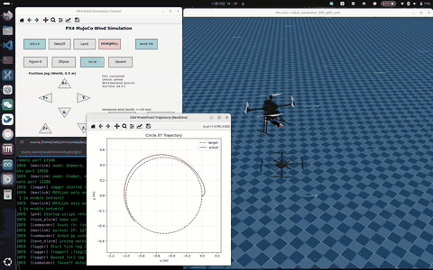

# Wind_disturbance_simulation_part1

[English](README.md) | **简体中文**

基于 MuJoCo 与 PX4 SITL 的单无人机风扰动仿真，使用搭载 Airbot Play 机械臂的 X4-950，支持 PINN 气动力预测与交互式轨迹控制。

## 演示

| X4-950 + Airbot Play 模型 | 控制面板 |
| --- | --- |
|  |  |

| 演示视频（动态预览） | 圆形轨迹跟踪 |
| --- | --- |
|  |  |
| [播放 / 下载完整 MP4](docs/media/videos/Wind%20field%20simulation%20Demo.mp4) | 灰色虚线：目标；红色：实际轨迹 |

## 功能

- PX4 闭环飞行，支持 XYZ 目标与八字、椭圆、圆形、方形轨迹。
- 可调的均匀水平风，合速度范围 0–3 m/s。
- 使用预训练 X4-950 PINN，将风输入转换为附加气动力。
- MuJoCo 场景、控制面板和轨迹对比图。

## 安装

验证环境：**Ubuntu 24.04 x86-64 / Python 3.12**，MuJoCo 3.6.0、NumPy 2.4.4、PyTorch 2.11.0、Matplotlib 3.10.9；图形界面需要 Tk 与 OpenGL。

PX4 运行包需要 Gazebo Transport 13、Messages 10、Protobuf 等系统库。按[安装说明](docs/INSTALL.zh-CN.md)补齐依赖，启动前确认 **ldd** 无 “not found”。

~~~bash
git clone https://github.com/Chenghao-Huang1218/Wind_disturbance_simulation_part1.git
cd Wind_disturbance_simulation_part1
python3.12 -m venv .venv
source .venv/bin/activate
python -m pip install torch==2.11.0 --index-url https://download.pytorch.org/whl/cpu
python -m pip install -e '.[dev]'
ldd runtime/px4/bin/px4
~~~

## 启动

在仓库根目录打开两个终端。

**终端 1：PX4 SITL**

~~~bash
source .venv/bin/activate
bash scripts/run_px4_sitl.sh
~~~

**终端 2：MuJoCo 与控制面板**

~~~bash
source .venv/bin/activate
python scripts/run_simulation.py
~~~

模型权重与 PX4 程序已随仓库提供，正常运行无需重新训练或编译。

## 控制面板

1. 等待 **PX4: connected**，点击 **Unlock**，确认 **armed** 后点击 **Takeoff**。
2. 使用 **X± / Y± / Z±**，按 0.5 m 步长调整世界坐标目标，或选择预设轨迹。
3. 输入 X/Y 风速（m/s），点击 **Apply Wind**；点击 **Wind OFF** 开启风，**Wind ON** 关闭风。
4. 点击 **Land**，等待落地后点击 **Exit**，关闭仿真与启动器拥有的 PX4 进程。

| 控件 | 功能 |
| --- | --- |
| Figure-8 / Ellipse / Circle / Square | 八字 / 椭圆 / 圆形 / 方形轨迹 |
| Apply Wind | 应用 X/Y 新值，不自动开启风 |
| Set / Speed | 已应用分量 / 合风速 |
| Emergency | 立即停止仿真转子 |

初始风速输入为空。水平合风速满足 $\sqrt{w_x^2+w_y^2}\le3$ m/s，正值表示空气沿世界坐标正方向流动。竖直风速与实际竖直扰动力均为零，蓝色标记显示水平风向。

## 实现方法

默认 **pinn-x4** 后端在每步以同一飞机状态计算有风、无风的加速度差：

$$
\mathbf a_{\mathrm{wind}}^W
=P_{xy}R_{WB}\bigl[
g_\theta(R_{WB}^{T}(\mathbf v_O^W-\mathbf w^W),\boldsymbol\omega^B)
-g_\theta(R_{WB}^{T}\mathbf v_O^W,\boldsymbol\omega^B)
\bigr].
$$

$R_{WB}$ 将机体系映射到世界系，$\mathbf v_O^W$ 为机体原点速度，$\mathbf w^W$ 为风速，$P_{xy}=\operatorname{diag}(1,1,0)$ 保留水平加速度。

结果依次经过 EMA（$\alpha=0.05$）、各轴 ±6 m/s² 限幅，再乘整机质量 8.0004 kg，施加到根 body。

模型由二次阻力先验与 **6→64→64→3 Tanh 残差网络**组成。现有试验权重使用 **3,000 组有风/无风合成配对样本**，参考模型来自 XML 提取的 29 个部件阻力代理；采样/训练 seed 为 7/42。该模型采用简化参考数据，未做实机气动标定。

PINN 训练图与技术文档

- [参考模型](docs/x4-950-reference-v1.md)
- [模型卡](docs/models/x4-950-pinn-pilot-v1.md)
- [训练报告](docs/X4_PINN_PILOT_2026-11-10.md)
- [SITL 集成报告](docs/X4_PINN_INTEGRATION_2026-11-10.md)
- [PX4 运行包与源码来源](docs/px4.md)

